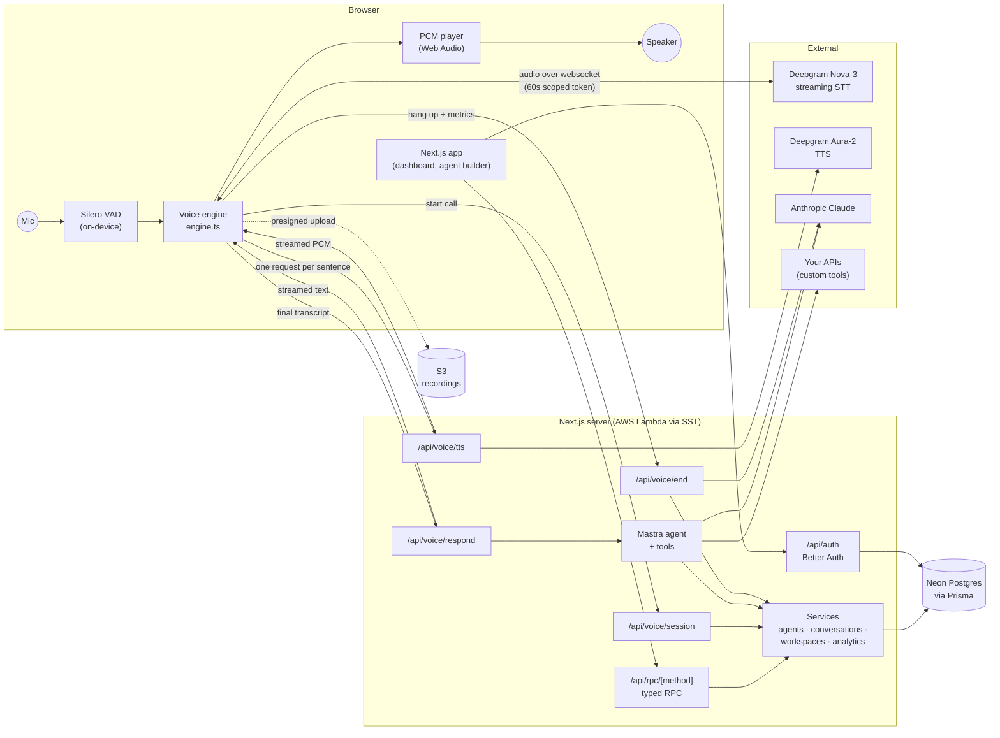
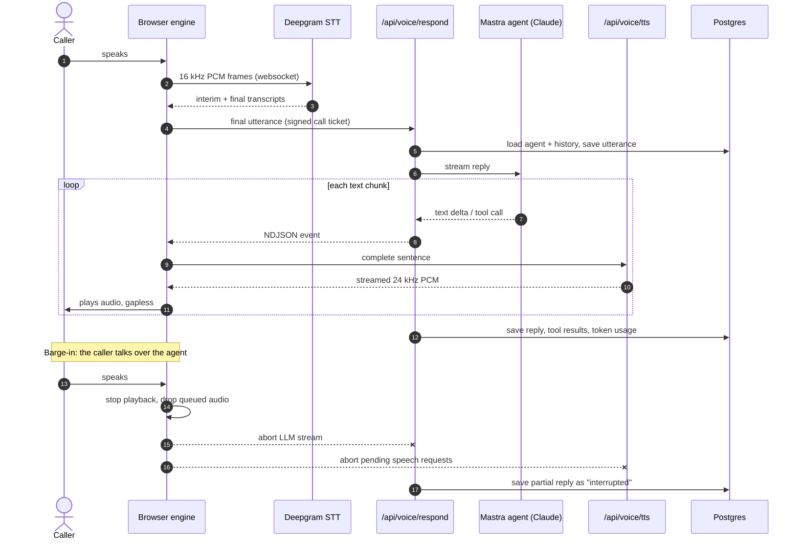
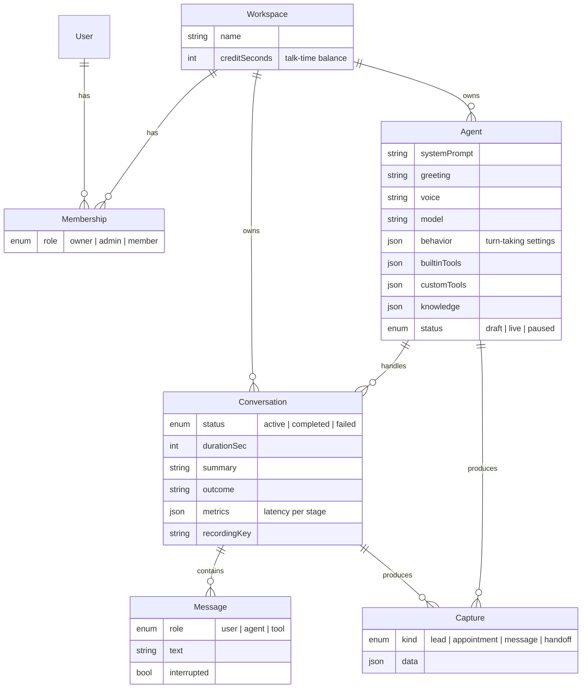

# Ringlet

**AI phone agents that talk like people, and let callers interrupt them.**

Ringlet lets a business build a voice agent (a receptionist, a sales rep, a
support line) in a few minutes, test it with a live call in the browser, and
read every conversation afterwards with the leads and bookings it captured.

---

## The problem

Small businesses miss calls. Every missed call is a lead, a booking or a
customer question that goes to a competitor. Hiring people to answer the phone
all day is expensive, and the usual alternatives are bad:

- **Phone menus** ("press 1 for…") frustrate callers and can't answer real questions.
- **Voicemail** loses most callers before they leave a message.
- **Most voice bots feel robotic.** They wait for you to finish, pause too long,
  and keep talking when you try to cut in.

Building a good voice agent yourself means stitching together speech
recognition, a language model, speech synthesis and a lot of real-time audio
work. That's months of infrastructure before you can focus on the conversation.

## What Ringlet does

Ringlet handles the real-time voice pipeline, so you only describe the agent:
who it is, what it knows, and what it's allowed to do.

- **It sounds natural.** Replies start streaming within a second of the
  caller stopping, sentence by sentence, so there's no long silence.
- **Callers can interrupt.** If the caller talks over the agent, it stops
  mid-word, drops what it was going to say, and listens. This is the hardest
  part to get right, and it matters most for how the call feels.
- **It does real work.** During the call the agent saves leads, books
  appointments, takes messages, looks up answers in your documents, calls
  your own APIs, and hands off to a human.
- **Every call is reviewable.** You get a turn-by-turn transcript (including
  where the caller cut the agent off), an AI summary and outcome, the captured
  records, optional recordings, and latency metrics.

## Features

| Area | What you get |
| --- | --- |
| **Agent builder** | 9 starting templates (receptionist, sales rep, support, appointment scheduler, lead qualifier, real estate, restaurant host, survey, blank). Set the personality, instructions, greeting, voice, language and model, and tune turn-taking (endpointing, silence timeout, interruptions, max call length). |
| **Built-in tools** | `capture_lead`, `book_appointment`, `take_message`, `search_knowledge`, `transfer_to_human`, `end_call`, each switchable per agent. |
| **Custom tools** | Point the agent at your own HTTPS endpoint (GET/POST). Calls time out after 8s, and private and internal addresses are blocked. |
| **Knowledge base** | Up to 200k characters of documents per agent. Small knowledge bases go straight into the prompt; larger ones are split into passages and searched by the agent as needed. |
| **Live test calls** | Talk to any agent from the browser with your mic, with a live transcript and call state. |
| **Conversations** | Full transcripts with tool calls and interruptions marked, plus an AI summary, an outcome label (`appointment_booked`, `lead_captured`, `transferred`, …), recordings and per-call latency metrics. |
| **Captures** | One inbox for every lead, appointment, message and handoff across all agents. |
| **Usage analytics** | Calls and talk time per day, per-agent breakdowns, failure and interruption counts, and token and speech usage. |
| **Workspaces and teams** | Multi-tenant workspaces with `owner` / `admin` / `member` roles. Every read and write is checked against the caller's membership. |
| **Talk-time balance** | Each workspace has a balance of call minutes. New workspaces get a 15-minute trial, and admins top up with `bun run grant-minutes`. Calls can't run past the remaining balance. |

---

## Architecture

### System overview



The browser does the latency-critical audio work: voice activity detection,
streaming speech recognition directly to Deepgram, and gapless playback. The
server handles anything that needs secrets or the database: the agent turn,
speech synthesis, persistence and billing. API keys never reach the browser.

### One conversational turn



The agent starts speaking after its **first sentence**, not after the full
reply. Synthesis for later sentences runs in parallel and plays in order.

### Data model



---

## The hard parts

The problems that took the real work, and the files to read first.

### Barge-in: [`src/lib/voice/engine.ts`](src/lib/voice/engine.ts)

Letting the caller talk over the agent takes more than muting the speaker.
When on-device VAD (or two or more transcribed words) detects speech while
the agent is talking:

- playback stops at once and queued audio is dropped;
- the **in-flight LLM stream and every pending speech request are aborted**,
  so the server stops generating a reply nobody will hear;
- the partial reply is saved as `interrupted`, so the transcript shows what
  the caller actually heard;
- the new utterance becomes the next turn, and the model sees that it was cut off.

Get the abort order wrong and the agent talks over itself, or you pay for
tokens and speech that get thrown away.

### Gapless playback: [`src/lib/voice/player.ts`](src/lib/voice/player.ts)

Speech arrives as a stream of PCM chunks per sentence. Each chunk is scheduled
on the Web Audio clock instead of played as it arrives, so sentences don't
click or drift apart, and playback can still stop instantly.

### Keys stay on the server: [`src/lib/server/ticket.ts`](src/lib/server/ticket.ts)

The browser needs a direct websocket to Deepgram for low-latency speech
recognition, but must never hold the API key. `/api/voice/session` creates a
60-second scoped Deepgram token, plus a signed **call ticket**. The ticket lets
the speech route authorize each sentence without a database lookup.

### Billing talk time safely: [`src/server/services/conversations.ts`](src/server/services/conversations.ts)

A call is capped at the workspace's remaining balance when it starts. When it
ends, the duration is subtracted in a single SQL update that can't go below
zero, so two calls ending at once can't overspend the balance.

---

## Tech stack

| Layer | Choice |
| --- | --- |
| App | Next.js 16 (App Router), React 19, TypeScript, Tailwind v4, shadcn/ui, TanStack Query |
| Voice | Silero VAD (ONNX, in browser), Deepgram Nova-3 (STT) and Aura-2 (TTS), Web Audio |
| Agent | Mastra on Anthropic Claude (Haiku by default, chosen per agent) |
| Data | Neon Postgres, Prisma 7 |
| Auth | Better Auth (email and password, session cookies) |
| Storage | S3 with presigned browser uploads, for recordings |
| Ops | SST (AWS Lambda + CloudFront), Sentry (errors, traces, latency metrics), GitHub Actions CI |
| Tooling | bun, ESLint, `bun test` |

## Project layout

```
src/
  app/(app)/          dashboard, agents, conversations, captures, usage, settings
  app/api/voice/      session · respond · tts · token · end  (the call hot path)
  app/api/rpc/        one typed endpoint for every dashboard query and mutation
  lib/voice/          browser voice engine and PCM player
  mastra/             agent, prompt building, tools, knowledge search
  server/             auth, access checks, Prisma client, RPC router, services
prisma/               schema and migrations
```

## Running locally

You need [bun](https://bun.sh), a Neon (or any Postgres) database, and
Deepgram and Anthropic API keys.

```bash
bun install
cp .env.example .env.local   # fill in DATABASE_URL, DIRECT_URL, BETTER_AUTH_SECRET,
                             # DEEPGRAM_API_KEY, ANTHROPIC_API_KEY, RINGLET_SESSION_SECRET
bun run db:migrate           # create the tables
bun run dev                  # http://localhost:3000
```

| Command | What it does |
| --- | --- |
| `bun run dev` | Start the dev server |
| `bun run typecheck` | Generate Prisma and route types, then type-check |
| `bun run test` | Unit tests |
| `bun run lint` | ESLint |
| `bun run build` | Production build |
| `bun run grant-minutes` | Add talk time to a workspace |
| `bun run deploy` | Deploy to AWS with SST (see [`sst.config.ts`](sst.config.ts)) |
