# Ringlet — architecture and internal workflows

This is the single reference for Ringlet's internal diagrams. It is derived from the code in `src/`, `prisma/`, `scripts/`, `sst.config.ts` and `.github/workflows/ci.yml`, not from `docs/setup.md` (see [Documentation drift](#documentation-drift)).

The runtime is a Next.js 16 App Router application deployed with SST on AWS Lambda. The browser owns the latency-critical audio path; the server owns secrets, the agent turn, persistence and billing.

---

## 1. System context / runtime topology

Sources: `src/lib/voice/engine.ts`, `src/app/api/voice/*`, `src/server/*`, `src/mastra/*`, `sst.config.ts`.

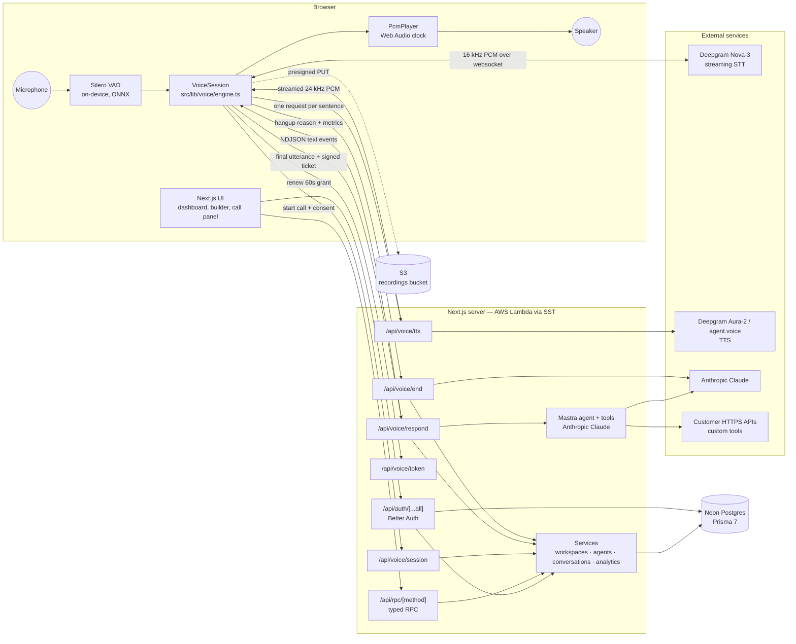

**Boundary rule:** API keys (`DEEPGRAM_API_KEY`, `ANTHROPIC_API_KEY`) and `RINGLET_SESSION_SECRET` never reach the browser. The browser holds only a 60-second Deepgram grant and a signed call ticket.

---

## 2. Data model

Source: `prisma/schema.prisma`, `prisma/migrations/20261109000000_init/migration.sql`, `src/server/schemas.ts`.

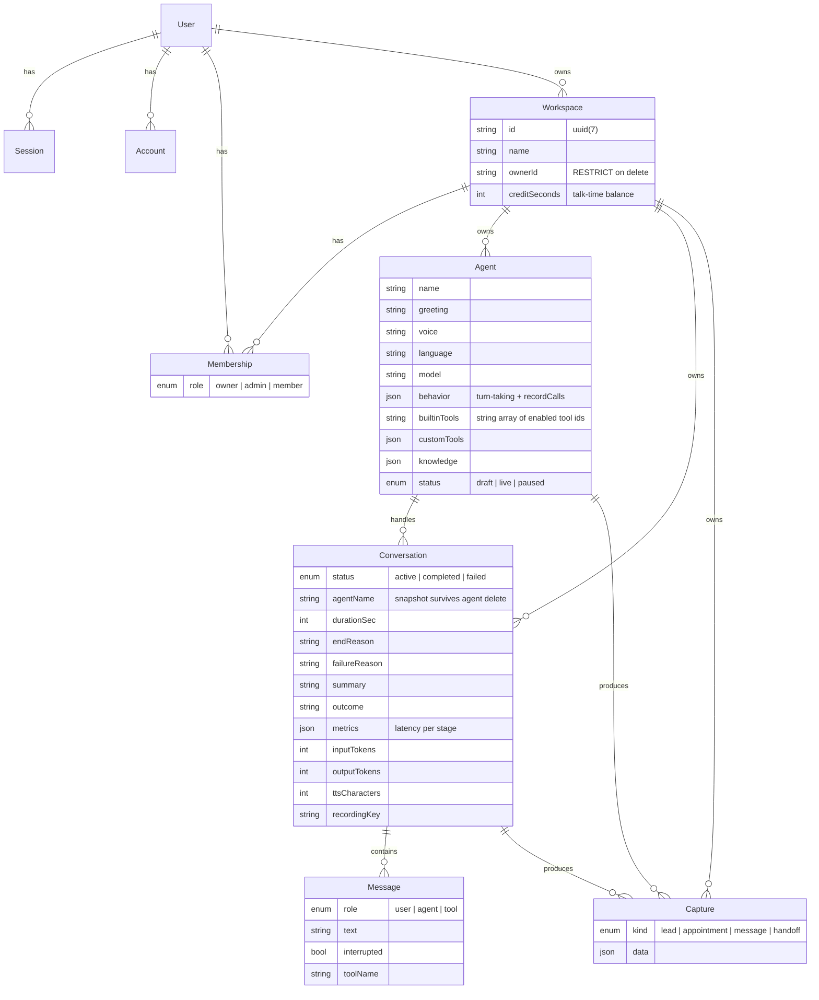

`Agent` and `Conversation` use `ON DELETE SET NULL` for `agentId`: deleting an agent preserves call history because each conversation snapshots `agentName`. Everything else cascades from `Workspace`.

---

## 3. Authentication and request boundaries

Sources: `src/server/auth.ts`, `src/app/api/auth/[...all]/route.ts`, `src/proxy.ts`, `src/lib/auth-client.ts`, `src/components/workspace.tsx`.

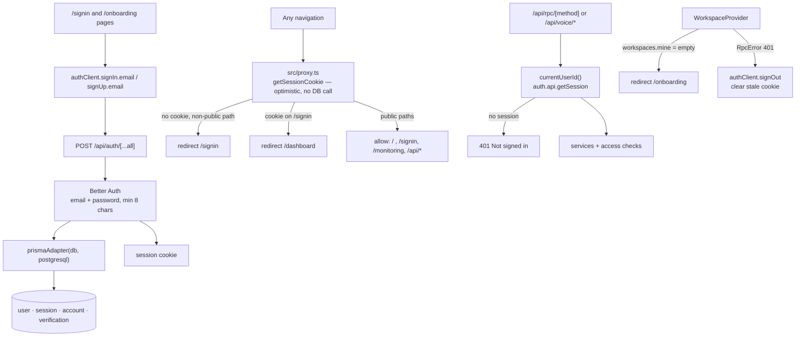

`RINGLET_SESSION_SECRET` is **not** a login secret. It only signs short-lived call tickets (`src/lib/server/ticket.ts`).

---

## 4. Typed RPC pipeline (all dashboard reads and writes)

Sources: `src/server/rpc.ts`, `src/app/api/rpc/[method]/route.ts`, `src/lib/rpc.ts`, `src/components/providers.tsx`, `src/server/errors.ts`.

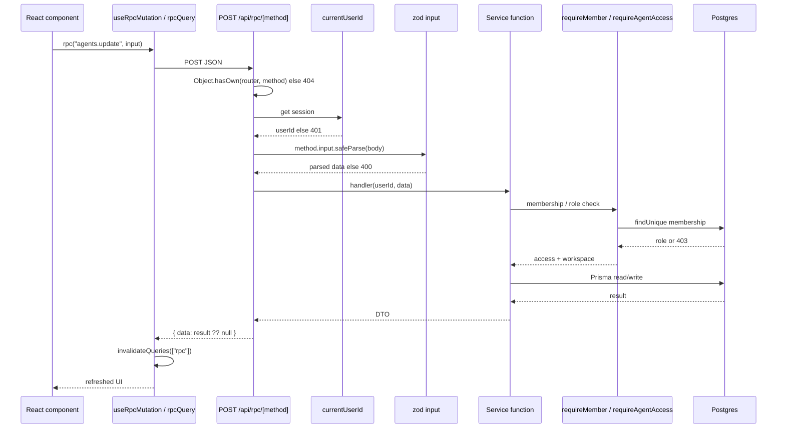

Registered method families: `workspaces.*` (mine, get, create, rename, members, addMember, removeMember), `agents.*` (list, get, create, update, setStatus, remove), `conversations.*` (list, get, captures, recordingUploadUrl, attachRecording), `analytics.overview`.

Query defaults: `staleTime: 10s`, refetch on window focus, retry only for 5xx/unknown errors and fewer than 2 retries.

---

## 5. Access-control decision tree

Source: `src/server/access.ts`; UI mirror in `src/components/workspace.tsx` (`canManage`).

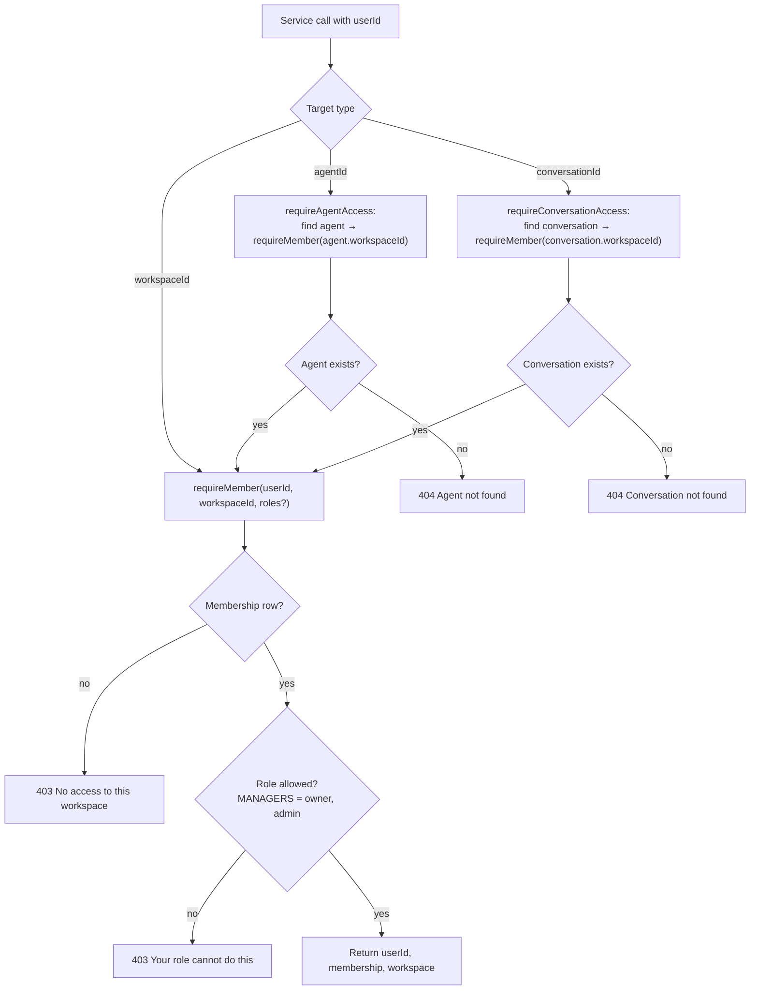

Read methods accept any role. `workspaces.rename/addMember/removeMember` and all `agents.*` writes require an owner or admin.

---

## 6. Workspace and agent setup

Sources: `src/app/onboarding/page.tsx`, `src/server/services/workspaces.ts`, `src/lib/shared/templates.ts`, `src/components/agent-form.tsx`, `src/server/services/agents.ts`.

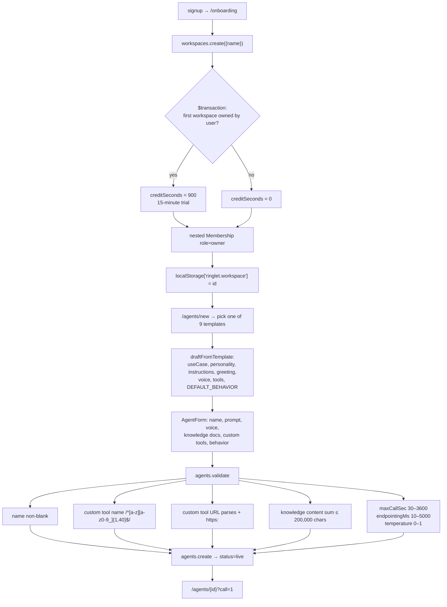

Only the **first** workspace a user owns receives trial minutes. Additional workspaces start at zero and need an operator top-up via `bun run grant-minutes`.

---

## 7. Call bootstrap

Sources: `src/lib/voice/engine.ts` (`start`), `src/app/api/voice/session/route.ts`, `src/server/services/conversations.ts` (`start`), `src/lib/server/ticket.ts`, `src/lib/server/deepgram.ts`.

```mermaid
sequenceDiagram
    actor U as User
    participant P as CallPanel / demo widget
    participant E as VoiceSession.start
    participant S as POST /api/voice/session
    participant C as conversations.start
    participant D as Postgres
    participant DG as Deepgram auth

    U->>P: click Call
    P->>E: start({agentId, recordingConsent})
    E->>S: POST {agentId, recordingConsent}
    S->>S: currentUserId else 401
    S->>S: zod: agentId 1–64, consent boolean
    S->>C: start(userId, args)
    C->>C: requireAgentAccess
    C->>D: load agent + workspace
    C->>C: paused? creditSeconds < 10?
    C-->>S: 402 / paused error / start result
    C->>D: create Conversation(status=active, agentName snapshot)
    C-->>S: conversationId, agent, maxCallSec, recording
    par
        S->>DG: POST /v1/auth/grant {ttl_seconds:60}
        DG-->>S: sttToken
    and
        S->>D: addMessage(agent greeting)
    end
    S-->>E: {conversationId, ticket, sttToken,<br/>maxCallSec, recording, agent config}
    E->>E: new AudioContext + resume
    E->>E: getUserMedia (echo cancel, noise suppression, AGC, mono)
    E->>E: new PcmPlayer; optional MediaRecorder(dest of mic + agent audio)
    E->>E: openStt(sttToken) → wss Deepgram
    E->>E: startVad() → Silero v5 from /vad/
    E->>E: timers: maxCallSec timeout + 1s silence watchdog
    E->>E: speakScripted(greeting)
    Note over E,DG: maxCallSec = min(agent.behavior.maxCallSec, workspace.creditSeconds)
    Note over E,S: ticket = HMAC-SHA256 over base64url {c, v, exp}<br/>TTL = maxCallSec + 600; v = agent.voice
```

Startup failures call `onError(...)` then `end("setup_failed", message)`; the session route closes any conversation it created with the same reason.

---

## 8. Browser call state machine

Source: `src/lib/voice/engine.ts` (`setState`, `runTurn`, `bargeIn`, `onPlaybackIdle`, `end`).

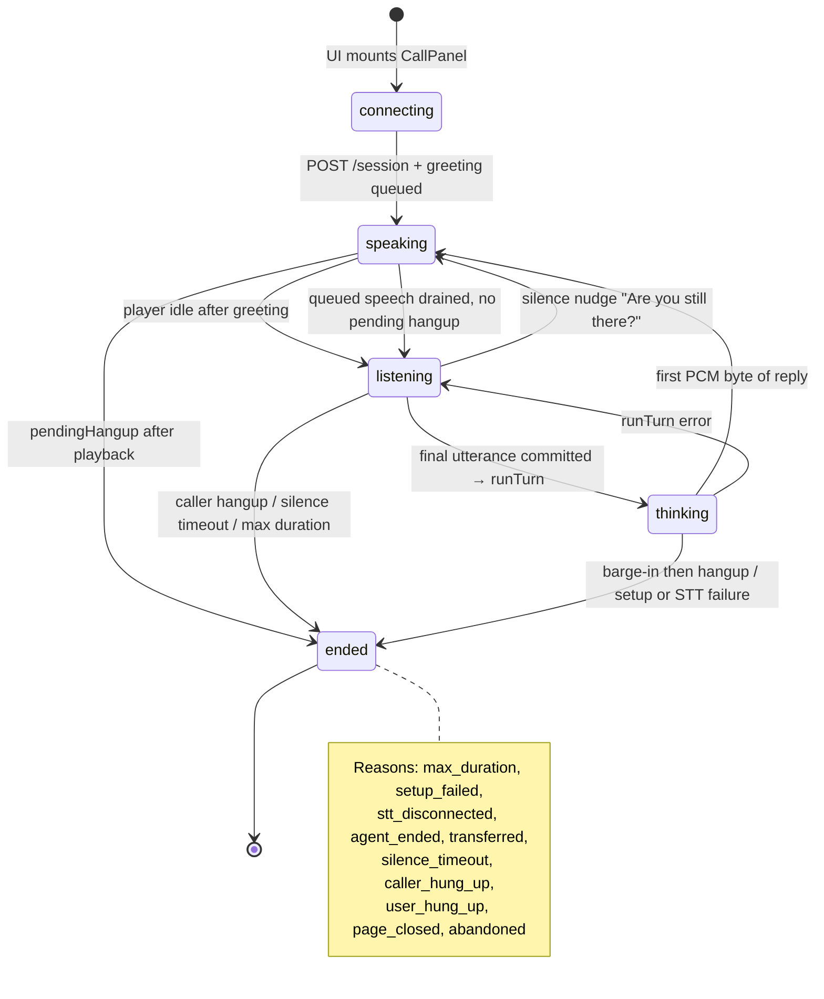

`setState` refuses to emit after `state === "ended"`.

---

## 9. Speech input: VAD, Deepgram websocket and barge-in triggers

Sources: `src/lib/voice/engine.ts` (`openStt`, `reconnectStt`, `onSttMessage`, `startVad`, `bargeIn`), `src/app/api/voice/token/route.ts`.

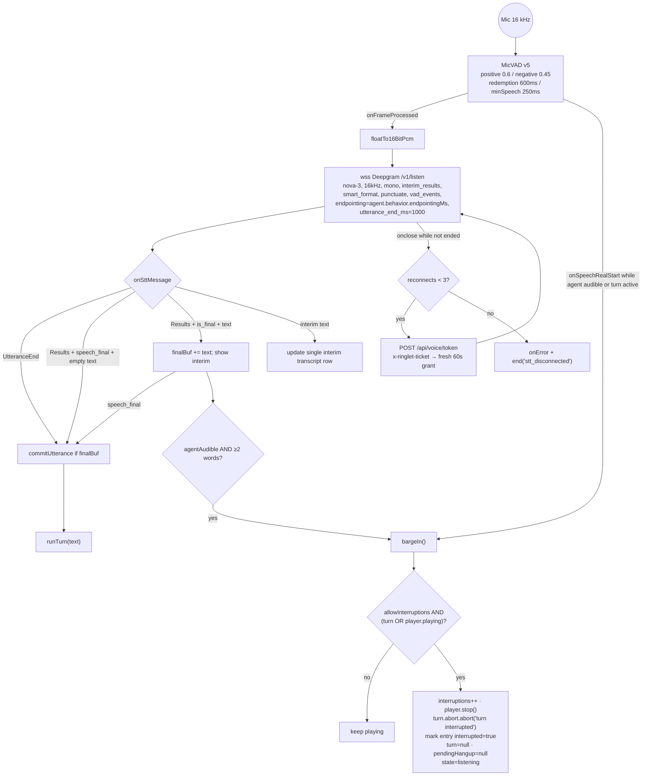

Interim text updates one transcript row in place; final text clears `finalBuf` and starts a turn. Any non-empty transcript resets the silence nudge.

---

## 10. One conversational turn (end-to-end sequence)

Sources: `src/lib/voice/engine.ts` (`runTurn`, `enqueueSpeech`), `src/app/api/voice/respond/route.ts`, `src/app/api/voice/tts/route.ts`, `src/lib/voice/player.ts`.

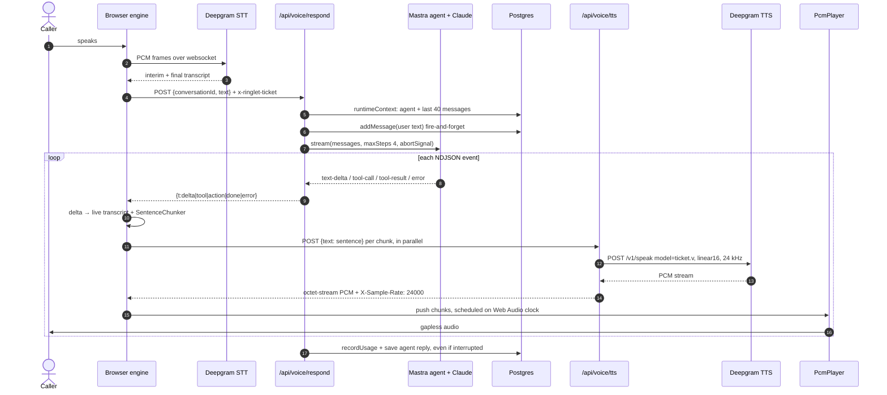

The browser starts speaking after the **first sentence**; later sentences are synthesized in parallel and played in order through `turn.chain`.

### NDJSON event contract (`RespondEvent`)

| Event | Server emits when | Browser behavior |
| --- | --- | --- |
| `{ t: "delta", text }` | model `text-delta` | Append to transcript, feed `SentenceChunker` |
| `{ t: "tool", name }` | model `tool-call` | Ignored by the engine |
| `{ t: "action", action, reason? }` | `tool-result` for `end_call` / `transfer_to_human`, not an error | Set `pendingHangup`; transfer also adds a system transcript line |
| `{ t: "done", firstTokenMs }` | after stream + usage | Ignored by the engine |
| `{ t: "error", message }` | stream error or thrown exception, unless request aborted | Throw → `onError`, state back to `listening` |

Server-side `firstTokenMs` is measured from request start; the client's `llmFirstTokenMs` is measured from VAD speech end. They are different metrics and are not interchangeable.

---

## 11. Server-side agent turn internals

Source: `src/app/api/voice/respond/route.ts`.

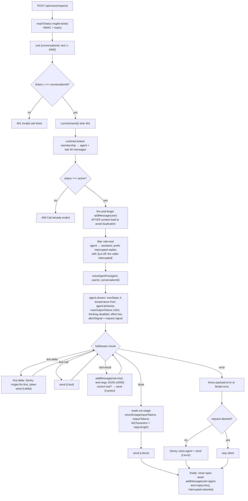

History is Postgres-backed, not Mastra memory: no `storage` or `memory` is configured. Only the latest 40 messages are replayed, and no summary is folded into the prompt.

---

## 12. Agent prompt assembly

Source: `src/mastra/index.ts` (`buildInstructions`, `voiceAgentFor`), `src/lib/shared/templates.ts`.

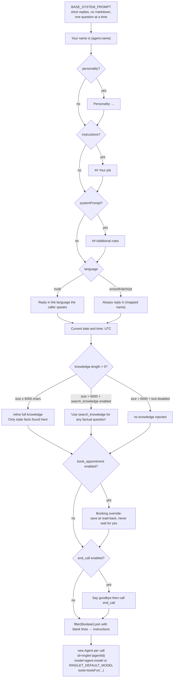

The greeting is **not** in the prompt. It is persisted as an `agent` message at session start and spoken by the browser via scripted TTS.

---

## 13. Tool execution and SSRF boundary

Sources: `src/mastra/tools.ts`, `src/server/services/conversations.ts` (`addCapture`), `src/server/access.ts`.

```mermaid
flowchart TD
    Call["Model emits tool-call"] --> Reg{"toolsFor(agent)"}
    Reg --> BI["Built-ins filtered by agent.builtinTools:<br/>capture_lead · book_appointment · take_message<br/>search_knowledge · transfer_to_human · end_call"]
    Reg --> CU["Custom tools merged AFTER built-ins<br/>(same name overrides built-in)"]
    BI --> Kind{"Which tool?"}
    CU --> Guard["new URL(t.url)"]
    Guard --> Check{"https: AND<br/>hostname NOT matching PRIVATE_HOST?"}
    Check -->|no| Blocked["return {error:'Tool URL is not allowed'}<br/>no network request"]
    Check -->|yes| Fetch["fetch with redirect:'manual',<br/>AbortSignal.timeout(8000),<br/>GET=query params, POST=JSON body,<br/>response text sliced to 2000 chars"]
    Kind -->|capture_lead| Cap["addCapture('lead')"]
    Kind -->|book_appointment| Cap2["addCapture('appointment', status=requested)"]
    Kind -->|take_message| Cap3["addCapture('message')"]
    Kind -->|transfer_to_human| Cap4["addCapture('handoff') + action"]
    Kind -->|end_call| Act["return {ending:true, reason} + action"]
    Kind -->|search_knowledge| Search["searchKnowledge(agent.knowledge, query)"]
    Cap --> Merge{"kind = appointment<br/>and one already exists?"}
    Cap2 --> Merge
    Merge -->|yes| Update["merge JSON: {...existing, ...new}<br/>one booking per call, corrections update it"]
    Merge -->|no| Insert["insert Capture row"]
    Cap3 --> Insert
    Cap4 --> Insert
    Search --> Hits{"hits?"}
    Hits -->|no| NoHit["{results:[], note:'Nothing found. Do not guess'}")
    Hits -->|yes| Hit["top 3 {source, text} back into model context"]
```

`PRIVATE_HOST` blocks `localhost*`, `127.*`, `10.*`, `192.168.*`, `169.254.*`, `172.16–31.*`, `0.*`, `::1` and IPv6 `fc/fd` prefixes. It is a string/regex guard: DNS names resolving to private IPs and IPv4-mapped IPv6 are not resolved or blocked. Redirects are not followed.

Tool messages stored in `Message` contain the **arguments**, not the tool result. Custom-tool fetch errors throw and surface as an NDJSON `error` event rather than a tool result.

---

## 14. Knowledge base pipeline

Sources: `src/components/agent-form.tsx`, `src/server/services/agents.ts`, `src/mastra/index.ts`, `src/mastra/knowledge.ts`, `tests/logic.test.ts`.

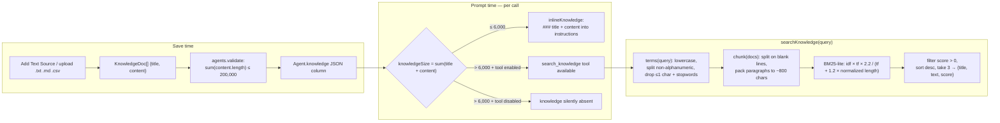

There is no embedding model or vector store. Chunks are recomputed on every search and never persisted.

---

## 15. Sentence chunking, parallel synthesis and gapless playback

Sources: `src/lib/voice/player.ts`, `src/lib/voice/engine.ts` (`enqueueSpeech`, `onPlaybackIdle`), `tests/logic.test.ts`.

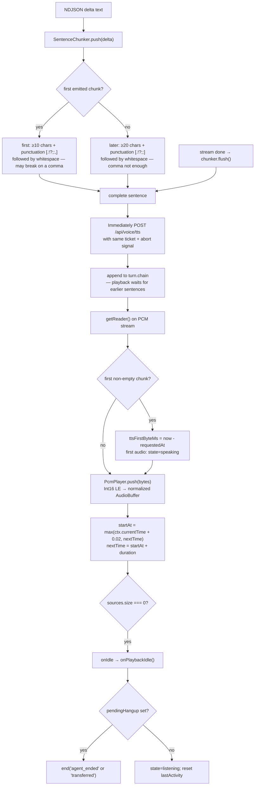

`PcmPlayer.stop()` nulls `onended`, stops all sources, clears `leftover` and resets `nextTime` — this is the instant-silence path used by barge-in. A 20 ms lead-in prevents clicks.

---

## 16. Barge-in: abort and partial-reply persistence

Sources: `src/lib/voice/engine.ts` (`bargeIn`, `runTurn`), `src/app/api/voice/respond/route.ts` (`finally`), `src/app/api/voice/tts/route.ts`.

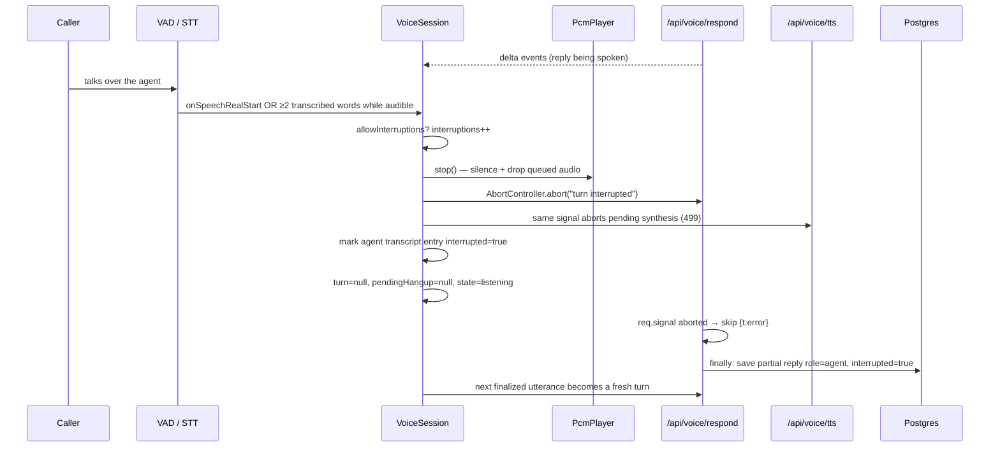

Getting the abort order wrong makes the agent talk over itself or wastes tokens and TTS on audio nobody hears.

---

## 17. Call end, billing and post-call summary

Sources: `src/lib/voice/engine.ts` (`end`), `src/app/api/voice/end/route.ts`, `src/server/services/conversations.ts` (`finish`, `settle`), `src/mastra/index.ts` (`summarizer`).

```mermaid
sequenceDiagram
    participant B as Browser engine
    participant E as POST /api/voice/end
    participant C as conversations service
    participant D as Postgres
    participant S as Sentry
    participant A as Summarizer agent (Claude)

    B->>B: clear timers, abort turn, stop player/VAD/WS/mic
    B->>B: state = ended
    B->>E: keepalive POST {conversationId, endReason,<br/>failed?, metrics averages}
    E->>C: finish(userId, args)
    C->>D: requireConversationAccess
    C->>D: settle() transaction:
    D->>D: UPDATE conversation SET status/endReason/<br/>metrics/endedAt/durationSec WHERE status='active'
    D->>D: if count=0 return null (idempotent)
    D->>D: UPDATE workspace SET creditSeconds =<br/>GREATEST(0, creditSeconds - durationSec)
    C-->>E: durationSec
    E->>S: ringlet.call.<metric>Ms distributions;<br/>warning if failed
    E->>C: get() → messages + captures
    alt caller spoke
        E->>A: transcript ≤30,000 chars + saved capture kinds
        A-->>E: {summary, outcome, unsavedBooking|null}
        E->>C: addDraftAppointment if unsavedBooking and no appointment
        E->>E: outcome guard:<br/>appointment_booked→appointment,<br/>lead_captured→lead, message_taken→message,<br/>transferred→handoff; else downgrade to "other"
        E->>C: setSummary(summary ≤4000, outcome ≤60)
    else no caller messages
        E->>C: setSummary("The caller did not speak.", "no_answer")
    end
    E-->>B: {durationSec}
    B->>B: upload recording (if any), close AudioContext, onEnded
```

`durationSec = max(1, ceil((endedAt - startedAt) / 1000))`, capped only for the stale reaper. Settlement happens before summarization, so a summarizer failure leaves a billed, completed call without a summary.

### Talk-time accounting

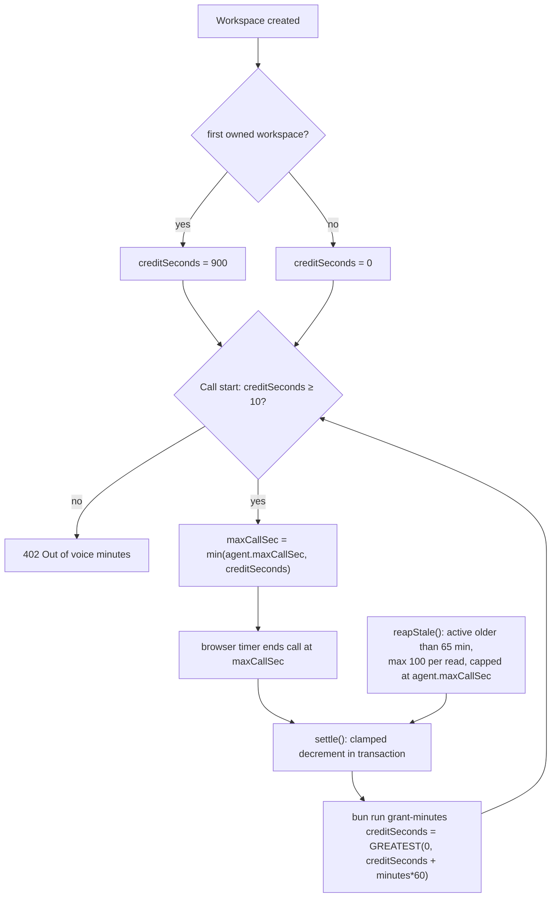

The reaper is lazy: it runs from `conversations.list` and `analytics.overview`, not from a cron. There is no payment provider in the current code — an operator tops up minutes manually.

---

## 18. Recording lifecycle

Sources: `src/lib/voice/engine.ts`, `src/server/recordings.ts`, `src/server/services/conversations.ts`, `src/components/call-panel.tsx`.

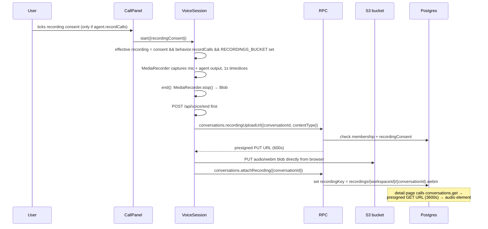

`deleteRecording` exists in `src/server/recordings.ts` but is not called anywhere.

---

## 19. Dashboard read and analytics aggregation

Sources: `src/server/services/analytics.ts`, `src/server/services/conversations.ts`, `src/app/(app)/dashboard/page.tsx`, `src/app/(app)/usage/page.tsx`.

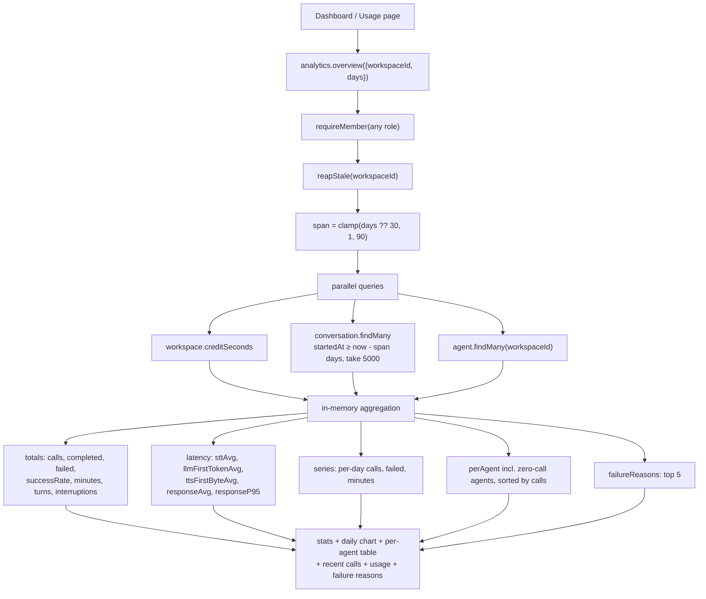

Conversation list reads also call `reapStale` and cap `take` at 500 (dashboard requests 200). Captures are limited to the latest 200 rows per workspace and exported to CSV in the browser.

---

## 20. Observability flow

Sources: `src/instrumentation.ts`, `next.config.ts`, voice routes.

```mermaid
flowchart LR
    subgraph Emit["Emission points"]
        M1["/respond: ringlet.llm.first_token<br/>+ span agent.turn / ai.agent"]
        M2["/tts: ringlet.tts.upstream_headers"]
        M3["/end: ringlet.call.turns,<br/>.interruptions, .sttLatencyMs,<br/>.llmFirstTokenMs, .ttsFirstByteMs,<br/>.responseLatencyMs"]
        M4["error tags: voice.session, voice.respond,<br/>voice.persist, voice.agent, voice.end,<br/>voice.tts, voice.client, voice.demo, rpc"]
    end
    subgraph Sentry["Sentry"]
        DSN["withSentryConfig<br/>tunnelRoute /monitoring<br/>tracesSampleRate default 0.2"]
        Metrics["distributions + spans + errors"]
    end
    M1 --> DSN
    M2 --> DSN
    M3 --> DSN
    M4 --> DSN
    DSN --> Metrics
    Metrics --> Dash["Sentry performance + Ringlet<br/>latency section in dashboard"]
```

---

## 21. Deployment and CI

Sources: `.github/workflows/ci.yml`, `sst.config.ts`, `package.json`, `scripts/copy-vad-assets.mjs`.

```mermaid
flowchart TD
    Push["push to main / pull_request"] --> CI["GitHub Actions: check"]
    CI --> Bun["setup-bun 1.3.6"]
    Bun --> Install["bun install --frozen-lockfile<br/>postinstall: prisma generate + copy VAD assets to public/vad"]
    Install --> Typecheck["bun run typecheck<br/>prisma generate → next typegen → tsc --noEmit"]
    Install --> Lint["bun run lint"]
    Install --> Test["bun run test<br/>sentence chunker + knowledge search"]
    Typecheck --> Gate{"all green?"}
    Lint --> Gate
    Test --> Gate

    Gate -->|manual| Deploy["bun run deploy → sst deploy --stage production"]
    Secrets["bunx sst secret set:<br/>DatabaseUrl, BetterAuthSecret, BetterAuthUrl,<br/>DeepgramApiKey, AnthropicApiKey,<br/>SessionSecret, SentryDsn"] --> Deploy
    Migrate["bun run db:deploy<br/>prisma migrate deploy against Neon"] --> Deploy
    Deploy --> Bucket["sst.aws.Bucket('Recordings')<br/>CORS GET + PUT"]
    Deploy --> Nextjs["sst.aws.Nextjs('Ringlet')<br/>Lambda 60s timeout, 1024 MB<br/>env injects secrets + bucket + Sentry"]
    Nextjs --> Prod["production: removal=retain, protect=true"]
```

SST links the recordings bucket so server functions receive AWS credentials automatically. CI has no deploy job; deployment is operator-run.

---

## Documentation drift

These are known inconsistencies between documents and code. Trust the code.

| Document | Claim | Reality in this checkout |
| --- | --- | --- |
| `AGENTS.md` / `CLAUDE.md` | Convex guideline block | `convex/_generated/ai/guidelines.md` does not exist; no Convex code to govern. The block is re-added by tooling, so it is not removed from the diff. |
| `src/components/landing/call-demo.tsx` | `sessionPath="/api/voice/demo-session"` | No `demo-session` route exists. Only `session`, `token`, `respond`, `tts`, `end` are implemented. |
| `README.md` | "Deepgram Aura-2" TTS | Code uses the per-agent `agent.voice` string carried in the ticket as the Deepgram `model`. The template defaults are Aura-2 voice IDs. |

### Test coverage note

Only `tests/logic.test.ts` exists: it pins the sentence chunker and knowledge search. There are no automated tests for the voice state machine, barge-in abort ordering, ticket validation, tool SSRF guard, event protocol, billing idempotency or summarizer outcome repair.
